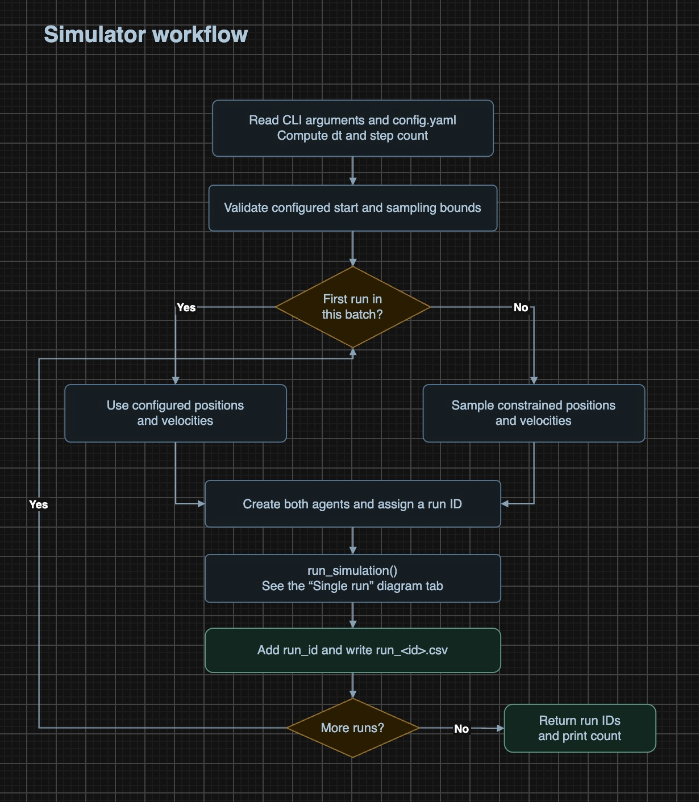

# 3D Point-Mass Pursuit–Evasion Simulator

A Python simulator for two agents moving in three dimensions. The pursuer responds to the evader's motion while the evader steers toward a fixed destination. Each run produces a CSV trajectory that you can replay or analyze. The model tracks position and velocity in world coordinates and advances both agents together using fourth-order Runge–Kutta integration (RK4).

This project is supposed to serve as a pre-lude to my upcoming project regarding probabilistic methods of determining an evader's future most-likely trajectories
using neural-networks.

[Read the technical report (PDF)](<assets/report.pdf>)


The open circles mark the initial positions, the filled markers show the agents at the displayed time, and the star marks the destination.

## Simulator workflow



[Open the editable workflow diagram](assets/workflow.drawio)

The first run in **each batch** uses the initial conditions in `config.yaml`. Subsequent runs sample new starting states under the configured distance, speed, and heading constraints. To compare the reference case with three randomized starts, request four runs in a single invocation.

## Navigation geometry

Let $\mathbf r_p,\mathbf v_p$ be the pursuer's position and velocity, and let $\mathbf r_e,\mathbf v_e$ be the evader's. Positions are in meters and velocities in meters per second. The point-mass equations for each agent are

$$
\dot{\mathbf r}_i=\mathbf v_i,\qquad \dot{\mathbf v}_i=\mathbf a_i,\qquad i\in\{p,e\}.
$$

The pursuer uses proportional navigation with an alternate turning mode. Its geometry depends on two different observations: how fast the agents close and how fast the line between them rotates. Define relative position, relative velocity, range, and line-of-sight direction as

$$
\boldsymbol\rho=\mathbf r_e-\mathbf r_p,\qquad
\mathbf u=\mathbf v_e-\mathbf v_p,\qquad
R=\lVert\boldsymbol\rho\rVert,\qquad
\hat{\boldsymbol\ell}=\boldsymbol\rho/R.
$$

For positive separation, the closing speed and line-of-sight angular velocity are

$$
V_c=-\hat{\boldsymbol\ell}\cdot\mathbf u,\qquad
\boldsymbol\omega_{\mathrm{LOS}}=\frac{\boldsymbol\rho\times\mathbf u}{R^2}.
$$

Positive $V_c$ means the range is shrinking. For example, two agents moving directly toward each other can have a large closing speed while their line of sight stays fixed.

The evader combines destination steering with a proximity response. Let $\hat{\mathbf g}$ point from the evader toward the destination and let $\hat{\mathbf t}$ be its unit velocity direction. The lateral component of the destination direction is

$$
\mathbf g_\perp=\hat{\mathbf g}-(\hat{\mathbf g}\cdot\hat{\mathbf t})\hat{\mathbf t}.
$$

When the evader is already moving directly toward the destination, this component is zero. Lateral acceleration changes the direction of travel while preserving speed in the continuous model. Recorded speed can drift under numerical integration.

## Reading a trajectory

Each `src/simulator/runs/run_<id>.csv` includes the initial state at time zero and one row per completed step. Each row contains the run ID, time, both agents' positions and velocities, destination coordinates, and outcome.

| Outcome | Interpretation |
| --- | --- |
| `hit` | The inter-agent proximity check triggered. Only the final row has `intercepted = 1`. |
| `miss` | The evader entered the destination radius or the run reached its time limit. |

The simulator checks proximity along the segment between consecutive relative positions. As a result, the final timestamp marks the end of the detected interval, and the plotted endpoint can lie outside the radius that triggered the event.

## Usage

From the repository root, use Python **3.11.9**, the version specified in `pyproject.toml`. On macOS or Linux, create an environment and install the dependencies:

```bash
python3.11 -m venv .venv
source .venv/bin/activate
python -m pip install -r requirements.txt
```

Run a batch and open the interactive trajectory viewer:

```bash
python main.py --runs 4 --duration 40 --hertz 10 --seed 42
python visualize.py
```

At the viewer prompt, enter `y` and select a saved run by ID or filename. Close the plot to choose another run.

| CLI option | Default | Meaning |
| --- | ---: | --- |
| `--runs` | 1 | Number of runs in this invocation, including the configured first run |
| `--duration` | 40 | Maximum simulated seconds per run |
| `--hertz` | 10 | Integration steps per simulated second; 10 Hz gives a 0.1 s step |
| `--seed` | Unset | Random seed for repeatable sampled starts |

Edit `config.yaml` to change the starting states, destination, or model parameters. Run `python main.py --help` to view the CLI options.
